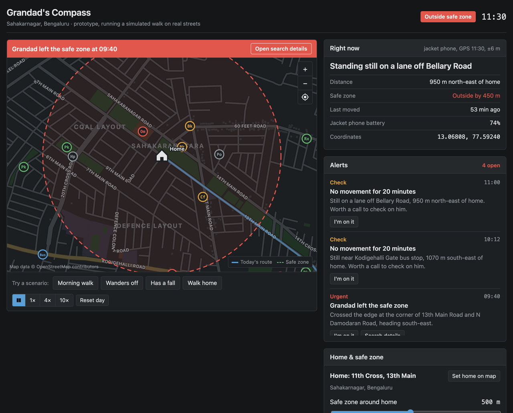

# Grandad's Compass

**Live demo: [grandads-compass.vercel.app](https://grandads-compass.vercel.app)**

My grandad had Alzheimer's, and we lost him once. After that, our family tracked him through an old phone sewn into his jacket. This is the dashboard I designed to do the watching for us: it shows where he is around Sahakarnagar, Bengaluru, and raises an alert when something looks wrong.

He has since passed away, so the version here is a working prototype. It runs a simulated walk on the real street map, so anyone can try every alert.



## What it does

- **Live map on real streets.** Roads, parks, temples, shops, clinics and bus stops come from OpenStreetMap. Every route follows the actual road network.
- **Safe zone.** A radius around home that you can adjust. The family gets a warning as he nears the edge and an urgent alert when he crosses it, naming the street and the direction he is heading.
- **Fall and inactivity alerts.** A possible fall (a hard jolt, then no movement) raises an urgent alert. So does staying still too long while away from home.
- **Plain-language status.** For example "Walking along Sahakaranagar Road, 300 m north-east of home", with coordinates and the jacket phone's battery level.
- **Day history.** A timeline of where he stopped and for how long, steps per hour, distance walked, time out of home, and how many times he left the safe zone.
- **If he goes missing.** A ready-to-send description for police or neighbours. It includes his last location, a Google Maps link, what he's wearing, and how to approach him.
- **Search helper.** "Plan a search" instantly ranks the places to check first by real walking distance, his heading and where he went today, splits them between two people, pins them on the map, and fills in a message for neighbours and police in Tamil and English. If an AI key is set, an AI agent then adds its own written plan, can explain an alert in context ("he usually sits at the temple for 15 minutes"), and answers questions about his day.
- **Works on phones.** Single-column layout on small screens. It can also be added to the home screen like an app.

## How it works

The whole app is one static `index.html` with no framework and no build step.

1. **Map data.** `tools/build_map.py` takes OpenStreetMap exports (from the Overpass API) for a 2.1 km × 1.5 km box around Sahakarnagar. It projects coordinates to metres and keeps only the largest connected part of the road network, so every route has a path. The result is about 41 KB of JSON embedded in the page: 1,547 street points, 526 road segments, 65 parks and buildings, and 19 named landmarks.
2. **Rendering.** The map is drawn as SVG in real-world metres, with pan and zoom. Markers and labels scale with the zoom level so they stay readable.
3. **Routing.** Dijkstra's algorithm with a binary heap over the road graph. Walking scenarios are chosen relative to home: his usual morning walk to the nearest temple and park; a bus stop outside the safe zone for wandering; the walk to the temple for a fall.
4. **Alerts.** Every location update is checked against the safe zone and the inactivity threshold. Street names come from the nearest road segment, and landmark and corner names from nearby points.

## The search helper

It has two layers.

1. **Map rules (always on, no key).** The page scores every named place by walking distance along real roads from his last position, with a bonus for places he went earlier today, places in the direction he was walking, and temples, parks and bus stops. It picks the top three, splits them between two people, and fills in the Tamil and English message from the "If he goes missing" details. A possible fall gets "go to him now" steps instead of a search.
2. **AI agent (optional).** An agent with seven tools: `get_status`, `get_movement`, `get_today_log`, `find_places`, `walking_route`, `get_person_details` and `mark_places_on_map`. The tools run in the page on the same map, routing and day log, so the agent never guesses a distance.

`api/helper.js` is a small Vercel function between the page and the AI provider. It keeps the API key off the page and fixes the model, instructions and tool list, so the page can only send the conversation. It also limits message count, size and requests per visitor. It uses **Gemini** (`gemini-3.8-flash`, which has a free tier) when `GEMINI_API_KEY` is set, otherwise **Claude** when `ANTHROPIC_API_KEY` is set. The page and the function use one small neutral format, so switching providers changes only that file.

The agent only advises. The safe-zone, fall and inactivity alerts work exactly as before, and its instructions forbid telling the family to ignore an urgent alert or delay calling the police.

To switch the agent on, add `GEMINI_API_KEY` (from Google AI Studio) to the Vercel project's environment variables and redeploy. Without a key, the map rules still work and the question box is hidden. Gemini's free tier may use requests to improve Google's products; this demo only sends the simulated walk.

## Run locally

```sh
python3 -m http.server 8000
# open http://localhost:8000
```

This serves the static app only. The map-rules search plan works there too. To try the AI agent locally, run `vercel dev` with `GEMINI_API_KEY` set.

## Project structure

| Path | What it is |
| --- | --- |
| `index.html` | The app: markup, styles, script and embedded map data |
| `api/helper.js` | Vercel function for the AI search helper (Gemini or Claude): fixed instructions, tool list and model, with request limits |
| `tools/build_map.py` | Turns OpenStreetMap exports into the embedded map JSON |
| `manifest.webmanifest`, `icon*.png`, `icon.svg` | Home-screen install support |
| `docs/screenshot.png` | README screenshot |

## Deploy

The site is static and hosted on Vercel. Every push to `main` redeploys it.

Map data © OpenStreetMap contributors, available under the ODbL.
