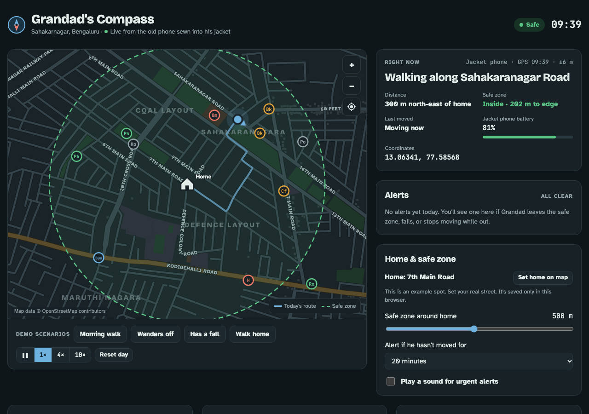

# Grandad's Compass

**Live demo: [grandads-compass.vercel.app](https://grandads-compass.vercel.app)**

My grandad had Alzheimer's, and we lost him once. This is the family dashboard I built for him. It showed where he was around Sahakarnagar, Bengaluru, and alerted us when something looked wrong. His location came from an old phone sewn into his jacket.

The version here runs a simulated walk on the real street map, so anyone can try every alert.



## What it does

- **Live map on real streets.** Roads, parks, temples, shops, clinics and bus stops come from OpenStreetMap. Every route follows the actual road network.
- **Safe zone.** A radius around home that you can adjust. The family got a warning as he neared the edge and an urgent alert when he crossed it. The alert named the street and the direction he was heading.
- **Fall and inactivity alerts.** A possible fall (a hard jolt, then no movement) raised an urgent alert. So did staying still too long while away from home.
- **Plain-language status.** For example "Walking along Sahakaranagar Road, 300 m north-east of home", with coordinates and the jacket phone's battery level.
- **Day history.** A timeline of where he stopped and for how long, steps per hour, distance walked, time out of home, and how many times he left the safe zone.
- **If he goes missing.** A ready-to-send description for police or neighbours. It includes his last location, a Google Maps link, what he's wearing, and how to approach him.
- **Works on phones.** Single-column layout on small screens. It can also be added to the home screen like an app.

## How it works

The whole app is one static `index.html` with no framework and no build step.

1. **Map data.** `tools/build_map.py` takes OpenStreetMap exports (from the Overpass API) for a 2.1 km × 1.5 km box around Sahakarnagar. It projects coordinates to metres and keeps only the largest connected part of the road network, so every route has a path. The result is about 41 KB of JSON embedded in the page: 1,547 street points, 526 road segments, 65 parks and buildings, and 19 named landmarks.
2. **Rendering.** The map is drawn as SVG in real-world metres, with pan and zoom. Markers and labels scale with the zoom level so they stay readable.
3. **Routing.** Dijkstra's algorithm with a binary heap over the road graph. Walking scenarios are chosen relative to home: his usual morning walk to the nearest temple and park; a bus stop outside the safe zone for wandering; the walk to the temple for a fall.
4. **Alerts.** Every location update is checked against the safe zone and the inactivity threshold. Street names come from the nearest road segment, and landmark and corner names from nearby points.

## Run locally

```sh
python3 -m http.server 8000
# open http://localhost:8000
```

## Project structure

| Path | What it is |
| --- | --- |
| `index.html` | The app: markup, styles, script and embedded map data |
| `tools/build_map.py` | Turns OpenStreetMap exports into the embedded map JSON |
| `manifest.webmanifest`, `icon*.png`, `icon.svg` | Home-screen install support |
| `docs/screenshot.png` | README screenshot |

## Deploy

The site is static and hosted on Vercel. Every push to `main` redeploys it.

Map data © OpenStreetMap contributors, available under the ODbL.
